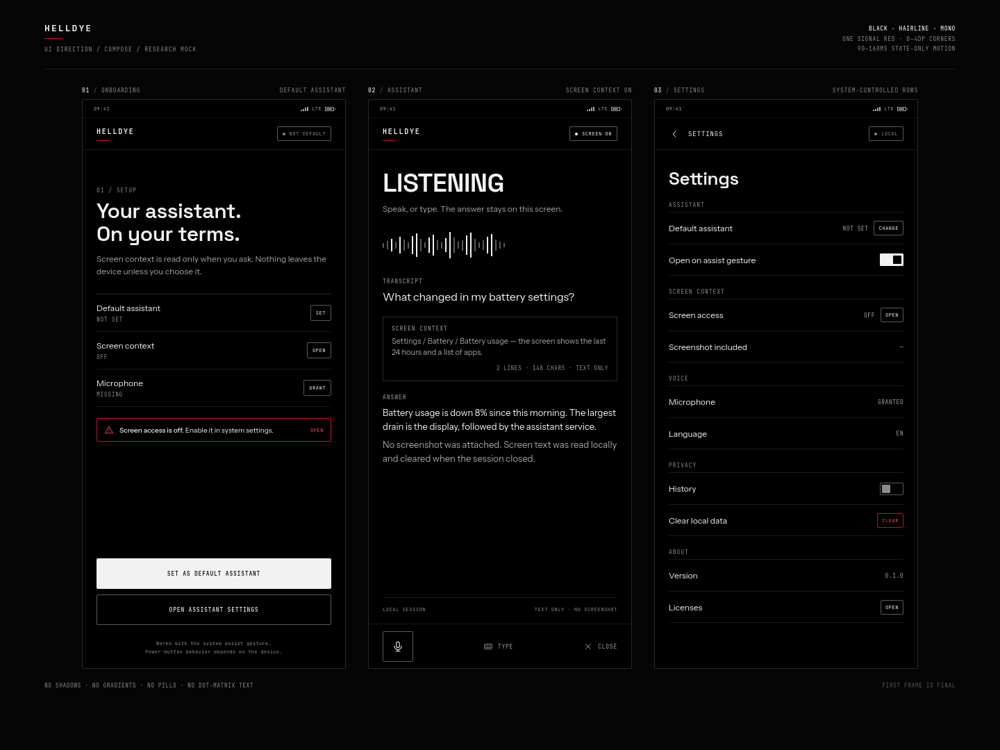
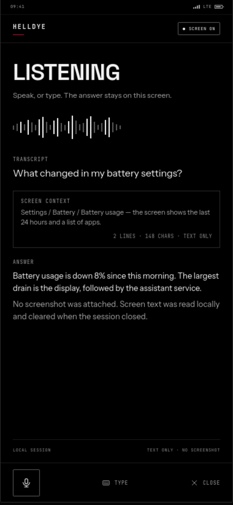

# HELLDYE — UI Design Report

Status: design direction and Compose implementation spec. No app code yet.
Scope: the assistant overlay, default-assistant onboarding, settings, and the states around them.

## 0. Visual mockup

- [`mockups/ui-board.html`](mockups/ui-board.html) — 1440×1080 web mockup board with the empty assistant, the screenshot strip, and settings.
- [`mockups/ui-board.png`](mockups/ui-board.png) — rendered board.
- [`mockups/assistant-screen.png`](mockups/assistant-screen.png) — assistant screen at 2×.





The mockup is an HTML/CSS visual target, not app code. It uses the exact token values in section 4.
The board and PNGs show the Phase 2 overlay: the empty assistant, the screenshot strip, and the flat
settings list. They are regenerated with the design refresh; there is no older version in the repo.

Screen context is screenshot-only (`docs/implementation-plan.md` §1.1): one staged capture, no text excerpt.
The screenshot strip is the only place where screen content appears.

---

## 1. Brief

**One line:** a black instrument panel with paper-thin rules, mono data, and one red signal.

The UI should feel like a tool that is already running, not an app that is introducing itself. Content is
visible on the first frame. Motion is feedback, never an entrance performance.

### Fixed constraints

| Constraint | Decision |
|---|---|
| AMOLED | Background `#000000`, true black, not Material `#121212`. |
| Not colorful | Grayscale + one red signal. No green/yellow/blue status colors. |
| Sharp corners | Panels `0dp`, controls `2dp`, dialogs/sheets `4dp`. No pills. |
| Understated type | Instrument Sans for reading, JetBrains Mono for data, Space Grotesk for display. |
| No dotted font | NDot/NDot55 is not used anywhere in the UI. No dot-matrix clocks or dot text. |
| No handwriting, not squished | No script fonts, no condensed display faces (Big Shoulders, Oswald, Barlow Condensed). |
| Fast motion | 90–160 ms, state changes only. No staggered or delayed entrances. |
| Warning language | Red is a 1dp outline + icon + label, never a large red fill. |

### Non-goals for v1

- No light theme. The app is dark-only; a later light theme is a separate design, not an inversion.
- No wallpaper dynamic color. `dynamicColor` stays off.
- No history dashboard, charts, cards grid, or decorative stats.
- No illustration set, mascot, glassmorphism, gradients, glows, or shadows.
- No screenshot gallery. One staged capture is shown as a 40×40 preview in the composer strip; there is no
  second copy, no history, and no browsing.

---

## 2. Reference analysis

### 2.1 lunanoir21 repos

These are desktop/Quickshell projects, not Android, but the visual language is consistent and directly
relevant: monochrome, hairline structure, dense data, mono labels, flat surfaces, no decoration.

| Repo | What to borrow | What to reject |
|---|---|---|
| [quickshell-quay](https://github.com/lunanoir21/quickshell-quay) | True black/white palettes; 3 surface steps; JetBrains Mono; contrast carries state, not hue; compact rows. | 22/14/8dp radii; pill chips; Big Shoulders Stencil (too condensed for this app). |
| [flare-notch](https://github.com/lunanoir21/flare-notch) | Critical red `#FF3F00`; white 8% dividers; `#1A1A1A` chips; mono metadata. | Colored status rings (green/yellow/blue); rounded sheet corners. |
| [tally-screentime](https://github.com/lunanoir21/tally-screentime) | Dense data, 7–14% hairlines, Bricolage Grotesque display + JetBrains Mono; one accent for the current state. | Orange accent; decorative rings; card-heavy dashboard. |
| [desktop-widget-control](https://github.com/lunanoir21/desktop-widget-control) | Instrument Sans + DM Mono; 11%/22% line hierarchy; flat editor panels. | Syne's quirkiness in body text; serif italic; multiple decorative fonts. |
| [quickshell-dynamic-island](https://github.com/lunanoir21/quickshell-dynamic-island) | Monochrome, mono labels, pixel clock as a single focal point. | Stencil display, pill container, pixel-art decoration. |
| [spec-mockup-design](https://github.com/lunanoir21/spec-mockup-design) | Anti-slop rules: one hierarchy, real states, no equal-card grids, restrained mono labels. | The "tiny uppercase mono everywhere" habit it warns about. |

Exact tokens observed in the reference code:

- Quay: `#000000`, `#0A0A0A`, `#161616`, `#262626`, `#6E6E6E`, `#A8A8A8`, `#F5F5F5`; JetBrains Mono; radii 22/14/8.
- Flare: critical `#FF3F00`, divider `white @ 8%`, chip `#1A1A1A`, sheet `#0A0B0D`; JetBrains Mono.
- Tally: hairline `9%`, line `7%`, outline `14%`, danger `#E0876A`; Bricolage Grotesque + JetBrains Mono.
- Desktop Widget Control: line `11%`, strong line `22%`, hover `7%`, danger `#E7907B`; Instrument Sans, DM Mono, Syne.

HELLDYE keeps the structure and drops the softness: sharper radii, neutral grays, one red, and no
color-coded state rings.

### 2.2 Nothing OS

Sources: [Nothing brand reference](https://nothing.wiki/nothing/brand_reference) (community reference) and
the [Nothing design-system analysis](https://www.shadcn.io/design/nothing).

What matches the target:

- Pure black/white foundation, monochrome icons, industrial/technical tone.
- N-Red `#C8102E`; widget red `#D71920`. Red is used as a signal, not as a surface color.
- NType82 is a clean grotesk; mono metadata fits the technical language.
- Flat graphics, no gradients, no shadows on brand graphics.
- A grid, generous margins, top-aligned content.

What HELLDYE rejects:

- NDot/NDot55 dot-matrix text. It is distinctive on a product page and tiring in a working UI.
- Dot-matrix clocks, glyph lights, and dot patterns as decoration.
- 6–8dp widget radii and pill-shaped chips. HELLDYE goes sharper: 0/2/4dp.
- Ultra-light display weights. On AMOLED they get thin and fragile; use 500/600.
- Yellow/blue accent colors and colored status rings.

### 2.3 Anti-slop rules

From `spec-mockup-design/references/anti-slop.md`, applied to this app:

- One dominant region per screen. The assistant status/answer is dominant; settings rows are quiet.
- Do not lay out equal rounded cards. Use sections separated by 1dp rules.
- Do not put tiny uppercase mono labels on everything. Mono is for data, metadata, and short button labels.
- Do not combine shadow + border + fill to separate the same surface. HELLDYE uses a 1dp border.
- Do not use gradients, glow, neon green/teal, or "hacker dashboard" decoration.
- Do not use pure `#FFFFFF` for large body text on black. Use `#F2F2F2`; pure white is for focus/emphasis.
- Show real empty, loading, error, and permission states; no placeholder content.

The one deliberate exception to the anti-slop guidance is true-black `#000000`. The user asked for AMOLED;
the harshness is reduced with off-white text and neutral grays rather than lifting the background.

---

## 3. Design principles

1. **Content first.** The first frame is the final layout. No fade-in of the page, no stagger, no delay.
2. **Structure with lines, not boxes.** 1dp rules and spacing create hierarchy; shadows and floating cards do not.
3. **Grayscale does the work; red is an alarm.** If red appears, something needs attention.
4. **Mono is data, not decoration.** Timestamps, status, counts, shortcuts, and short button labels. Body copy stays sans.
5. **One bold move.** The oversized mono status word (`LISTENING`, `THINKING`, `SCREEN OFF`) plus a red hairline
   when something is wrong. Everything else stays quiet.

---

## 4. Color

### 4.1 Tokens

| Token | Hex | Contrast on black | Use |
|---|---|---:|---|
| `Black` | `#000000` | — | App background, true AMOLED. |
| `Surface` | `#070707` | 1.04:1 | Optional small fill for inputs; not a page background. |
| `SurfaceRaised` | `#0D0D0D` | 1.08:1 | Dialogs/sheets when a fill step is needed. |
| `LineSoft` | `#1A1A1A` | 1.21:1 | Decorative dividers inside dense lists. |
| `Line` | `#2A2A2A` | 1.46:1 | Default 1dp border, list dividers. |
| `LineStrong` | `#5A5A5A` | 3.04:1 | Interactive control borders (passes 3:1). |
| `TextMuted` | `#8A8A8A` | 6.08:1 | Secondary metadata; still readable. |
| `TextSecondary` | `#A3A3A3` | 8.33:1 | Body secondary copy, descriptions. |
| `Text` | `#F2F2F2` | 18.76:1 | Primary text. |
| `White` | `#FFFFFF` | 21.00:1 | Focus ring, active icon, primary button fill only. |
| `Signal` | `#FF4D4D` | 6.42:1 | Error/warning text and icons, recording dot. |
| `SignalLine` | `#C8102E` | 3.57:1 | 1dp danger outline (Nothing N-Red). UI only, not small text. |
| `SignalDim` | `#1A0808` | 1.08:1 | Optional error container fill; keep it rare. |

There are no success/info/warning hues. Success is white + a check icon + the word `ON`. Information is gray.
Red is the only chroma, and it covers less than ~5% of any screen.

### 4.2 Rules

- **Default border:** 1dp `Line` for panels and dividers. **Interactive controls:** 1dp `LineStrong` (3:1).
- **Hover/press:** background white at 6–8%, no border change.
- **Focus:** 1dp `White` border. No glow, no outer ring, no double border.
- **Error/warning:** 1dp `SignalLine` border + `Signal` icon + `Signal` label. Never a filled red panel.
- **Disabled:** text `TextMuted`, border `LineSoft`, container transparent. Do not reduce opacity on the whole
  component; it drops contrast and makes text unreadable.
- **Selected:** 1dp `White` border or a 2dp white left rule; do not use red for selection.
- **Recording:** 6dp `Signal` dot + `RECORDING` mono label. No pulsing red glow.
- **Material mapping:** `primary` = white, `onPrimary` = black, `secondary` = `TextSecondary`, `error` =
  `Signal`, `errorContainer` = `SignalDim`. Set `surfaceTint` to transparent and all `surfaceContainer*`
  roles to black/`Surface` so Material components cannot introduce gray-lavender surfaces.

### 4.3 Contrast notes

- Body text uses `#F2F2F2`, not `#FFFFFF`. This reduces halation on AMOLED without dropping below AAA.
- `#C8102E` passes 3:1 for a 1dp non-text outline but fails 4.5:1 for small text. Use `#FF4D4D` whenever red
  carries words.
- `#8A8A8A` is the darkest gray allowed for meaningful small text (6.08:1). `#6E6E6E` (4.12:1) is decoration only.
- Never encode status by color alone. Pair red with a warning icon and a text label.

---

## 5. Typography

### 5.1 Families and roles

| Role | Family | Weights | Why |
|---|---|---|---|
| Display / screen titles / status word | **Space Grotesk** | 500, 600 | Sharp, geometric, not condensed; has more character than a default grotesk. |
| Reading / body / labels / inputs | **Instrument Sans** | 400, 500, 600 | Neutral, precise, excellent at 14–16sp; matches the reference apps. |
| Data / metadata / buttons | **JetBrains Mono** | 400, 500 | Readable mono, not squished, broad glyph coverage; used across the reference repos. |

All three are OFL and can be bundled. Do not ship Nothing's proprietary NType82 or NDot. If you want only
two families, drop Space Grotesk and use Instrument Sans 600 for display; do not drop JetBrains Mono, the mono
data layer is part of the identity.

Bundle the fonts in `res/font/`; do not use downloadable Google Fonts at runtime. Runtime download causes a
first-frame font swap and makes the "no waiting" rule impossible to guarantee.

### 5.2 Scale

| Style | Family | Size / line | Weight | Tracking | Use |
|---|---|---|---:|---:|---|
| `displayLarge` | Space Grotesk | 40 / 44 | 600 | -0.8sp | Assistant state: `LISTENING`, `THINKING`. |
| `headlineLarge` | Space Grotesk | 28 / 32 | 600 | -0.4sp | Onboarding/screen title. |
| `headlineMedium` | Space Grotesk | 24 / 30 | 500 | -0.2sp | Section hero, large numbers. |
| `titleLarge` | Instrument Sans | 20 / 26 | 500 | 0 | Dialog/sheet title. |
| `titleMedium` | Instrument Sans | 16 / 22 | 500 | 0 | Row group title. |
| `bodyLarge` | Instrument Sans | 15 / 22 | 400 | 0 | Answer, transcript, main copy. |
| `bodyMedium` | Instrument Sans | 14 / 20 | 400 | 0 | Descriptions, helper text. |
| `labelLarge` | JetBrains Mono | 12 / 16 | 500 | +0.5sp | Buttons (uppercase), field labels. |
| `labelMedium` | JetBrains Mono | 11 / 14 | 500 | +0.6sp | Status chips, metadata. |
| `labelSmall` | JetBrains Mono | 10 / 13 | 400 | +0.8sp | Rare micro metadata; do not overuse. |

Numeric style: JetBrains Mono is already tabular. For Instrument Sans numbers (counts in settings), set
`fontFeatureSettings = "tnum"`.

### 5.3 Type rules

- Use `PlatformTextStyle(includeFontPadding = false)` for sharp vertical rhythm; keep
  `LineHeightStyle.Trim.None` so Turkish ascenders/descenders are not clipped.
- Uppercase only for short labels and buttons (1–3 words). Body copy is sentence case.
- Do not use negative tracking on mono. It closes the counters and looks squished.
- Do not use NDot, script, handwriting, serif italic, or condensed display faces.
- Test `ĞÜŞİÖÇ ğüşıöç` and long Turkish strings at 1.0× and 2.0× font scale.
- When uppercasing English labels use `uppercase(Locale.ROOT)`; when the string is localized, use the string's
  locale so Turkish `i` becomes `İ` correctly.

---

## 6. Shape, spacing, borders, elevation

### 6.1 Radius

| Element | Radius |
|---|---:|
| Panels, list sections, banners | `0dp` |
| Buttons, inputs, chips, small controls | `2dp` |
| Dialogs, bottom sheets | `4dp` |
| Pills, circles for circular controls | Not used, except a 48dp square mic button and status dots |

The app should read as rectangles and rules, not as a stack of rounded cards. A 2dp radius is enough to avoid
a raw HTML look without becoming soft.

### 6.2 Spacing

4dp base grid: `4 / 8 / 12 / 16 / 24 / 32 / 48`.
Screen gutter `16dp`; list row height `56dp`; top bar `56dp`; button min height `48dp`; assistant content max
width `560dp`; line width `1dp` (use `1.dp`, not a hairline fraction that can disappear on low-density screens).

### 6.3 Separation hierarchy

1. Default: `1dp` `Line` border or divider.
2. Interactive controls / emphasized group: `1dp` `LineStrong` (3:1).
3. Active: `1dp` `White`.
4. Danger: `1dp` `SignalLine`.
5. Fill step (`Surface`, `SurfaceRaised`) only when a component must sit above the page, such as a dialog or
   a text field. Never combine a fill step with a shadow.

### 6.4 Elevation

- No `Modifier.shadow`, no `Card` elevation, no `tonalElevation`, no `shadowElevation`.
- No blur, no `RenderEffect`, no glass.
- Dialogue and sheet depth comes from a 1dp border and a black scrim (`Black @ 60%`).
- This keeps AMOLED black genuinely black and avoids the gray haze Material adds by default.

---

## 7. Motion

### 7.1 Tokens

| Token | Duration | Easing | Use |
|---|---:|---|---|
| `Press` | 90ms | `Enter` | Press scale/background; button feedback. |
| `Fast` | 120ms | `Enter` | Fade of a banner, chip, inline error. |
| `Small` | 160ms | `Enter` | Dialog/sheet enter, expanding panel. |
| Exit | 90–120ms | `Exit` | Any disappearance. |

```kotlin
object HelldyeMotion {
    const val Press = 90
    const val Fast = 120
    const val Small = 160
    val Enter = CubicBezierEasing(0.2f, 0.8f, 0.2f, 1f)
    val Exit = CubicBezierEasing(0.4f, 0f, 1f, 1f)
}
```

No springs, no bounce, no overshoot, no stagger, no delay. If a transition needs more than 160ms, the design is
wrong for this app.

### 7.2 Rules

- **Page entry:** none. The screen is laid out at its final position on the first frame. Do not wrap a whole
  page in `AnimatedVisibility` or `AnimatedContent` with a long spec.
- **Navigation:** if the app gains multiple screens, use a 120ms crossfade at the navigation layer; no shared-axis
  slide, no 300ms default.
- **State changes inside a screen:** 120ms fade or 160ms size change. The user already sees the result; motion only
  explains where it came from.
- **Text streaming:** append tokens with no per-token animation and no `animateContentSize`. Layout must not jump
  on every chunk.
- **List items:** never stagger. A list is fully present or not present.
- **Loading:** show the shell immediately; a 2dp indeterminate line at the top. No shimmer, no skeleton pulse, no
  spinner in the middle of the screen.
- **Press feedback:** background white at 8% or a scale to 0.98 over 90ms. No ripple bloom larger than the control.
- **Accessibility:** if `ValueAnimator.areAnimatorsEnabled()` is false, skip all non-essential animation and show
  the final state.

### 7.3 Anti-patterns

```kotlin
// Do not: artificial delay before content.
LaunchedEffect(Unit) {
    delay(250)
    visible = true
}

// Do not: default 300ms Material animations on a fast assistant.
AnimatedVisibility(visible = visible, enter = fadeIn(tween(300))) { ... }

// Do not: stagger rows.
items.forEachIndexed { index, item ->
    LaunchedEffect(Unit) { delay(index * 40L); shown = true }
}
```

---

## 8. Components

### 8.1 Buttons

| Variant | Container | Border | Text | Use |
|---|---|---|---|---|
| Primary | `White` | none | `Black` | One per screen: set default assistant. |
| Secondary | transparent | 1dp `LineStrong` | `Text` | Most actions. |
| Ghost | transparent | none | `TextSecondary` | Low-priority actions. |
| Danger | transparent | 1dp `SignalLine` | `Signal` | Destructive action, after confirmation. |

Height 48dp; horizontal padding 16dp; 2dp radius; label `labelLarge` uppercase; no icons unless the icon is
needed to disambiguate. Pressed: 8% white fill, 90ms. Disabled: `TextMuted` text, `LineSoft` border, no fill.

```kotlin
enum class HelldyeButtonStyle { Primary, Secondary, Danger }

@Composable
fun HelldyeButton(
    text: String,
    onClick: () -> Unit,
    modifier: Modifier = Modifier,
    style: HelldyeButtonStyle = HelldyeButtonStyle.Secondary,
    enabled: Boolean = true,
) {
    val container = if (style == HelldyeButtonStyle.Primary && enabled) {
        HelldyeColors.White
    } else {
        Color.Transparent
    }
    val content = when {
        !enabled -> HelldyeColors.TextMuted
        style == HelldyeButtonStyle.Primary -> HelldyeColors.Black
        style == HelldyeButtonStyle.Danger -> HelldyeColors.Signal
        else -> HelldyeColors.Text
    }
    val border = when {
        !enabled -> HelldyeColors.LineSoft
        style == HelldyeButtonStyle.Danger -> HelldyeColors.SignalLine
        style == HelldyeButtonStyle.Primary -> null
        else -> HelldyeColors.LineStrong
    }

    Button(
        onClick = onClick,
        enabled = enabled,
        modifier = modifier.heightIn(min = 48.dp),
        shape = RoundedCornerShape(2.dp),
        border = border?.let { BorderStroke(1.dp, it) },
        colors = ButtonDefaults.buttonColors(
            containerColor = container,
            contentColor = content,
            disabledContainerColor = Color.Transparent,
            disabledContentColor = HelldyeColors.TextMuted,
        ),
        elevation = null,
        contentPadding = PaddingValues(horizontal = 16.dp, vertical = 12.dp),
    ) {
        Text(text.uppercase(Locale.ROOT), style = MaterialTheme.typography.labelLarge)
    }
}
```

### 8.2 Text fields

- 1dp border, 2dp radius, black fill, 48dp minimum.
- Label above the field in `labelMedium`, uppercase, `TextMuted`.
- Focused: white border. Error: `SignalLine` border + `Signal` helper text.
- Placeholder `TextMuted`; entered text `Text`; cursor white.
- No filled gray input, no floating label animation, no 56dp Material default height.

```kotlin
@Composable
fun HelldyeTextField(
    value: String,
    onValueChange: (String) -> Unit,
    label: String,
    modifier: Modifier = Modifier,
    isError: Boolean = false,
) {
    val interaction = remember { MutableInteractionSource() }
    val focused by interaction.collectIsFocusedAsState()
    val border = when {
        isError -> HelldyeColors.SignalLine
        focused -> HelldyeColors.White
        else -> HelldyeColors.LineStrong
    }

    Column(modifier) {
        Text(label.uppercase(), style = MaterialTheme.typography.labelMedium, color = HelldyeColors.TextMuted)
        Spacer(Modifier.height(6.dp))
        BasicTextField(
            value = value,
            onValueChange = onValueChange,
            textStyle = MaterialTheme.typography.bodyLarge.copy(color = HelldyeColors.Text),
            cursorBrush = SolidColor(HelldyeColors.White),
            interactionSource = interaction,
            modifier = Modifier
                .fillMaxWidth()
                .heightIn(min = 48.dp)
                .border(1.dp, border, RoundedCornerShape(2.dp))
                .padding(horizontal = 12.dp, vertical = 12.dp),
            decorationBox = { inner ->
                Box {
                    if (value.isEmpty()) {
                        Text("Type here", style = MaterialTheme.typography.bodyLarge, color = HelldyeColors.TextMuted)
                    }
                    inner()
                }
            },
        )
    }
}
```

### 8.3 Status chip

2dp radius, 1dp border, 4dp dot, 6dp gap, `labelMedium` uppercase.

| Tone | Border | Text/dot | Use |
|---|---|---|---|
| Neutral | `LineStrong` | `TextMuted` | Off, unknown, not configured. |
| Active | `LineStrong` | `Text` | On, granted, ready. |
| Danger | `SignalLine` | `Signal` | Blocked, missing, error. |

```kotlin
enum class StatusTone { Neutral, Active, Danger }

@Composable
fun StatusChip(label: String, tone: StatusTone, modifier: Modifier = Modifier) {
    val content = when (tone) {
        StatusTone.Neutral -> HelldyeColors.TextMuted
        StatusTone.Active -> HelldyeColors.Text
        StatusTone.Danger -> HelldyeColors.Signal
    }
    val border = if (tone == StatusTone.Danger) HelldyeColors.SignalLine else HelldyeColors.LineStrong

    Row(
        modifier = modifier
            .border(1.dp, border, RoundedCornerShape(2.dp))
            .padding(horizontal = 8.dp, vertical = 4.dp),
        verticalAlignment = Alignment.CenterVertically,
    ) {
        Box(Modifier.size(4.dp).background(content, CircleShape))
        Spacer(Modifier.width(6.dp))
        Text(label.uppercase(), style = MaterialTheme.typography.labelMedium, color = content)
    }
}
```

### 8.4 Warning / error banner

One pattern for all warnings: 1dp `SignalLine` outline, 2dp radius, 12dp padding, `Signal` icon, `Text` copy,
optional mono action in `Signal`.

```kotlin
@Composable
fun WarningBanner(
    text: String,
    modifier: Modifier = Modifier,
    action: String? = null,
    onAction: (() -> Unit)? = null,
) {
    Row(
        modifier = modifier
            .fillMaxWidth()
            .border(1.dp, HelldyeColors.SignalLine, RoundedCornerShape(2.dp))
            .padding(12.dp),
        verticalAlignment = Alignment.CenterVertically,
    ) {
        Icon(Icons.Outlined.Warning, contentDescription = null, tint = HelldyeColors.Signal,
            modifier = Modifier.size(18.dp))
        Spacer(Modifier.width(8.dp))
        Text(text, style = MaterialTheme.typography.bodyMedium, color = HelldyeColors.Text,
            modifier = Modifier.weight(1f))
        if (action != null && onAction != null) {
            TextButton(onClick = onAction, contentPadding = PaddingValues(horizontal = 8.dp)) {
                Text(action.uppercase(), style = MaterialTheme.typography.labelMedium,
                    color = HelldyeColors.Signal)
            }
        }
    }
}
```

No red background. At most, a `SignalDim` fill can sit behind the outline, but the default is transparent.

### 8.5 Panels and list rows

- Panel: black background, 1dp `Line`, 0dp radius, 12–16dp padding. No shadow.
- List row: 56dp min height, 16dp horizontal padding, leading icon 20dp, title `bodyLarge`, trailing meta
  `labelMedium` `TextMuted`, 1dp divider. Pressed background white 6%.
- Section header: `labelMedium` uppercase `TextMuted`, 8dp top / 6dp bottom, no line above unless the section
  needs separation from a dense list.
- Do not turn every row into a card. A settings screen is a list, not a grid.

### 8.6 Top bar

- 56dp, black, no elevation, no shadow.
- Back icon 24dp on the left; title `titleMedium` at 20dp; optional mono status chip on the right.
- Bottom 1dp `Line` only when content scrolls under it.
- Assistant overlay: 56dp rail; wordmark `labelLarge`, session title `bodyMedium` ellipsized, state
  `labelMedium` mono, and at most two actions (overflow and close/back). No screen chip: the screenshot
  strip is the state. The display-size state word appears only on an empty transcript.

### 8.7 Dialogs and sheets

- Dialog: black fill, 1dp `LineStrong`, 4dp radius, 24dp padding, scrim black 60%.
- Title `titleLarge`; body `bodyMedium` `TextSecondary`; actions aligned right, 8dp gap.
- Destructive confirm: `WarningBanner` inside the dialog + `Danger` button; the confirm button is never filled red.
- Bottom sheet: black fill, 4dp top corners, 1dp top border, 32×2dp drag handle at 24% white.
- Enter 160ms fade + 4dp vertical; exit 120ms. No drag physics beyond the standard sheet behavior.

### 8.8 Snackbar

Black fill, 1dp `LineStrong`, 2dp radius, 12dp padding, one line of `bodyMedium`, action in `labelMedium`
`White`. No colored fill, no elevation. Appears at the bottom above the IME/navigation insets, 120ms fade.

### 8.9 Loading and progress

- Indeterminate: 2dp `LinearProgressIndicator`, color `Text`, track `Line`, butt stroke cap, full width under
  the top bar.
- No shimmer, no skeleton pulse, no centered spinner.
- If a region is not ready, reserve its final height and show `TextMuted` text (`LOADING`), so the layout
  does not jump when content arrives. An empty answer reserves a 44dp block and shows the 2dp line inside it;
  the shell, rail, and composer stay visible.
- Determinate progress: 2dp line, white on `Line`, numeric percentage in mono.

### 8.10 Waveform

- 48dp high, 2dp bars, 2dp gap, centered; inactive bars `LineStrong`, active bars `Text`.
- Use the real microphone RMS. Do not fake an infinite waveform animation; it is decoration and burns frames.
- If amplitude is unavailable, show a single 1dp horizontal rule with a 6dp `Signal` dot only while recording.
- No glow, no gradient, no mirrored bars with easing.

### 8.11 Icons

- 1.5dp stroke, 20dp or 24dp, outlined style, `TextSecondary`; active `Text`.
- Use `Icons.Outlined` or custom vectors; no filled Material icons, no emoji.
- Every interactive icon has a content description; decorative icons are `null`.
- Warning/error icon is `Signal`; do not recolor ordinary icons red.

---

## 9. Screens

### 9.0 Screenshot-only decision

Screen context is screenshot-only, and the screenshot is the only screen artifact the app may send. This
block is normative; it mirrors the screen-context rules in [`AGENTS.md`](../AGENTS.md) and
`docs/implementation-plan.md` §1.1.

- The assist gesture may capture one screenshot. The app never reads screen text: no OCR, no
  `AssistStructure` traversal, no `AccessibilityService`, no `MediaProjection`, and no clipboard scrape of
  the foreground app.
- The screenshot is staged in memory and sent only when the user submits. It is never written to
  preferences, files, logs, or the recents thumbnail; the gateway never writes it to disk.
- The screenshot strip is the only screen-context visual. There is no text excerpt, character count, OCR
  fallback, gallery, history, or second copy.
- A screen query is ephemeral (`--no-session`, read-only tools) and its answer is not added to a persistent
  transcript.
- `TEMP` is a temporary state, not an error. `OFF` and `BLOCKED` are honest states with no retry loop; a
  secure window or a disabled screen-context setting produces no capture.

### 9.1 Assistant overlay (primary)

Full-screen, opaque `#000000`. No translucency, no blur, no dim: the user must not see the app underneath,
and screen content is sensitive. The overlay appears immediately; there is no entrance animation.

Empty:

```text
HELLDYE                    SESSION 4F2A         READY        [⋮] [×]
────────────────────────────────────────────────────────────────────
READY
Ask about the screen, or type.
Screenshots stay on this phone until you send.

MODEL · THINKING · CONTEXT                                  (tappable)
[ + ]  Ask HELLDYE                                      [mic] [send]
```

With a screenshot staged and a turn:

```text
HELLDYE                    SESSION 4F2A      THINKING        [⋮] [×]
────────────────────────────────────────────────────────────────────
│ What is wrong with this layout?
The rail is taller than the content. I kept one 56dp rail.
  THINKING · 3 LINES
  3 TOOLS · 1 FAILED
[thumb] SCREEN   TEMP   1.2 MB                                  [×]
MODEL · THINKING · CONTEXT
[ + ]  Ask HELLDYE                                      [mic] [stop]
```

Specs:

- **Top rail:** 56dp, 16dp gutter. Wordmark `labelLarge`; session title `bodyMedium`, one line,
  ellipsized; state `labelMedium` mono. At most two actions: overflow and close/back. Settings, sessions,
  and "open session" live in the overflow. No duplicate screen chip. The display-size state word appears
  only when the transcript is empty. At 2.0× font scale the wordmark drops so the session title and
  state stay readable; nothing clips.
- **Turns:** no fill and no border. The user turn is a 2dp `White` left rule plus `bodyLarge` text. The
  assistant turn is plain markdown. 16dp between turns. No `YOU`/`HELLDYE` label per turn; speaker
  placement and the user rule carry the role.
- **Thinking:** one-line disclosure with a 1dp `LineSoft` top rule: `THINKING · 3 LINES`. Expand inline;
  the expanded text uses `bodyMedium` `TextMuted`. No fill.
- **Tools:** one-line row with a 1dp `LineSoft` top rule: name, duration, status, one-line summary. Failed
  status uses `Signal` text, never a filled panel. Consecutive tools collapse to `3 TOOLS · 1 FAILED` and
  expand inline to the individual rows.
- **Screenshot strip:** 56dp minimum, 1dp `Line` border, 2dp radius, 40×40 preview with a 1dp border,
  `SCREEN`, `TEMP`/`OFF`/`BLOCKED`, size in mono, and a 48dp remove target. One image only. `TEMP` is
  `TextMuted`; `BLOCKED` is `Signal`; there is no retry loop. Removing the strip drops the image.
- **Composer:** attach, input, mic, send/stop only. 1dp `LineStrong` border, 2dp radius, 48dp minimum,
  4dp inner padding. Send becomes stop while busy. No duplicate type/close controls.
- **Status line:** one line above the composer, `labelSmall` mono `TextMuted`, data only
  (`MODEL · THINKING · CONTEXT`). It is tappable and opens the model sheet, which also exposes the
  thinking level. Settings is in the overflow, not the attachment sheet.
- **Empty state:** plain content, no card and no border: `READY` in `displayLarge`, one sentence, one
  screenshot hint, and the composer.
- **Status rail:** one line, red only for failure: `SEND FAILED · RETRY` when the failure state exists;
  `RECONNECTING` and `OFFLINE` when Phase 4/7 wires those states. Until then the same rail shows the
  current error or notice with `DISMISS`.
- **Loading:** the shell, rail, and composer stay visible. Only an empty answer shows the 2dp indeterminate
  line, inside a reserved 44dp block. No shimmer, no skeleton, no `…`, no entrance animation.
- **No screenshot:** the assistant answers text-only; the UI never claims an image was attached.
- **Off/blocked:** the strip shows `SCREEN OFF` or `SCREEN BLOCKED` once; text-only send remains available;
  there is no automatic retry.
- The overlay stays opaque even when no screenshot is staged; a dimmed background would expose the app
  underneath and is not part of this design.

### 9.2 Onboarding / default assistant

One scrollable screen, no carousel, no illustrations. The role and permission state are the content.

```text
HELLDYE

Your assistant, on your terms.
Screen context is one screenshot. It leaves the device only when you send it.

DEFAULT ASSISTANT          NOT SET        [ SET ]
SCREEN CONTEXT             SYSTEM CONTROLLED  [ OPEN ]
MICROPHONE                 MISSING        [ GRANT ]
─────────────────────────────────────────────────
[ SET AS DEFAULT ASSISTANT ]        (primary, white)
[ OPEN SYSTEM SETTINGS ]            (secondary)
```

- Wordmark: `HELLDYE` in `labelLarge` with +0.12em tracking; 1dp red baseline under the `H` only.
- Title: `headlineLarge` 28/32, two lines max.
- Body: `bodyLarge` `TextSecondary`, 2–3 sentences max.
- Rows: 56dp, label `bodyLarge`, state `labelMedium` mono (`NOT SET`, `OFF`, `MISSING`), action `Ghost`.
- Primary action: white fill, black text, 2dp radius; only one.
- If the role is unavailable: replace the primary with a `WarningBanner`: "This device does not allow
  third-party assistants." Action `OPEN DEFAULT APPS`. Do not show a dead primary button.
- If the role is held: primary becomes `OPEN ASSISTANT` and a `StatusChip` shows `DEFAULT`.
- Screen capture is system-controlled and screenshot-only. Do not show a Switch; show status + `OPEN` and
  deep-link to the system default-assistant screen where the toggle lives. The product requests a
  screenshot only; it never asks for screen text.
- No permission request on first frame; request only after the user taps the row action. Show the system
  dialog and update the row immediately on return.

### 9.3 Settings

```text
SETTINGS

GATEWAY
  Gateway URL                 https://phone.tailnet.ts.net
  Token                       ••••••••
  Workspace                   /home/you/code
  [ SAVE ]                    (primary, white)
  [ TEST CONNECTION ]         (secondary)
PRIVACY
  Screen context              SCREENSHOT ONLY
  Screenshots                 MEMORY ONLY
ABOUT
  Version                     0.1.0
```

- Top rail 56dp: back icon + `SETTINGS` in `labelLarge`.
- One flat list, 16dp gutter. Sections are separated by one 1dp `LineSoft` rule; rows are 56dp minimum and
  are not cards.
- Section labels `labelMedium` uppercase `TextMuted`; row title `bodyLarge`; state `labelMedium` mono.
- Token is masked; it never renders in clear text. Host profile details are rows, not cards.
- One primary action per screen: `SAVE`. `TEST CONNECTION` is secondary. No cards around groups.
- Screen-context rows are informational; they cannot be toggled in-app. `OPEN` goes to the system screen.
- `Clear local data` opens a dialog with a `WarningBanner`; the confirm button is `Danger` outline, not
  filled red.

### 9.4 States matrix

| State | Visual | Copy | Action |
|---|---|---|---|
| Empty | Plain `READY` display word, no card or border | "Ask about the screen, or type." + screenshot hint | composer |
| Thinking | Rail `THINKING`; reserved 44dp answer block with 2dp line | No `…`; the shell stays visible | `STOP` |
| Answer | Plain markdown; user 2dp rule; 16dp between turns | Answer text | `ASK AGAIN` |
| Screenshot staged | 56dp strip, 40×40 preview, `SCREEN TEMP` | "One screenshot is staged. It is sent only when you send." | `×` remove |
| Capture off | Strip `SCREEN OFF` (Phase 3), no preview | "Screen capture is off. Enable it in settings." | `OPEN` |
| Secure screen | Strip `SCREEN BLOCKED` in `Signal` (Phase 3), no preview | "This screen does not allow screenshots." | none |
| Send failed | One-line rail `SEND FAILED · RETRY` in `Signal`; retry wiring lands with Phase 4 | What failed + one next step | `RETRY` or `DISMISS` |
| Reconnecting / offline | One-line rail, `TextMuted`; Phase 4/7 | `RECONNECTING` / `OFFLINE` | none |
| No mic permission | One-line rail | "Microphone permission is missing." | `GRANT` |
| No assistant role | Warning banner on onboarding | "This device does not allow third-party assistants." | `OPEN DEFAULT APPS` |
| Empty sessions | Flat sheet, one line | "No sessions match." | `NEW SESSION` |
| Error | One-line rail, `Signal` text | What failed + one next step | `DISMISS` |

Loading never replaces the whole screen. The shell, top rail, and composer remain visible; only the content
region shows the 2dp line or reserved space. Red is reserved for failure and blocked states; `TEMP` is not
an error.

---

## 10. Compose implementation

### 10.1 File layout

```
ui/theme/Color.kt
ui/theme/Type.kt
ui/theme/Shape.kt
ui/theme/Theme.kt
ui/theme/Dimens.kt
ui/components/HelldyeButton.kt
ui/components/HelldyeTextField.kt
ui/components/StatusChip.kt
ui/components/WarningBanner.kt
ui/components/Hairline.kt
ui/motion/Motion.kt
ui/assistant/AssistantScreen.kt
ui/onboarding/OnboardingScreen.kt
ui/settings/SettingsScreen.kt
res/font/instrument_sans_regular.ttf
res/font/instrument_sans_medium.ttf
res/font/instrument_sans_semibold.ttf
res/font/jetbrains_mono_regular.ttf
res/font/jetbrains_mono_medium.ttf
res/font/space_grotesk_medium.ttf
res/font/space_grotesk_semibold.ttf
```

### 10.2 Color.kt

```kotlin
object HelldyeColors {
    val Black = Color(0xFF000000)
    val Surface = Color(0xFF070707)
    val SurfaceRaised = Color(0xFF0D0D0D)
    val LineSoft = Color(0xFF1A1A1A)
    val Line = Color(0xFF2A2A2A)
    val LineStrong = Color(0xFF5A5A5A)

    val TextMuted = Color(0xFF8A8A8A)
    val TextSecondary = Color(0xFFA3A3A3)
    val Text = Color(0xFFF2F2F2)
    val White = Color(0xFFFFFFFF)

    val Signal = Color(0xFFFF4D4D)
    val SignalLine = Color(0xFFC8102E)
    val SignalDim = Color(0xFF1A0808)
}
```

### 10.3 Type.kt

```kotlin
val InstrumentSans = FontFamily(
    Font(R.font.instrument_sans_regular, FontWeight.Normal),
    Font(R.font.instrument_sans_medium, FontWeight.Medium),
    Font(R.font.instrument_sans_semibold, FontWeight.SemiBold),
)
val JetBrainsMono = FontFamily(
    Font(R.font.jetbrains_mono_regular, FontWeight.Normal),
    Font(R.font.jetbrains_mono_medium, FontWeight.Medium),
)
val SpaceGrotesk = FontFamily(
    Font(R.font.space_grotesk_medium, FontWeight.Medium),
    Font(R.font.space_grotesk_semibold, FontWeight.SemiBold),
)

private val SharpText = PlatformTextStyle(includeFontPadding = false)
private val SharpLines = LineHeightStyle(LineHeightStyle.Alignment.Center, LineHeightStyle.Trim.None)

val HelldyeTypography = Typography(
    displayLarge = TextStyle(
        fontFamily = SpaceGrotesk, fontWeight = FontWeight.SemiBold,
        fontSize = 40.sp, lineHeight = 44.sp, letterSpacing = (-0.8f).sp,
        platformStyle = SharpText, lineHeightStyle = SharpLines,
    ),
    headlineLarge = TextStyle(
        fontFamily = SpaceGrotesk, fontWeight = FontWeight.SemiBold,
        fontSize = 28.sp, lineHeight = 32.sp, letterSpacing = (-0.4f).sp,
        platformStyle = SharpText, lineHeightStyle = SharpLines,
    ),
    titleLarge = TextStyle(
        fontFamily = InstrumentSans, fontWeight = FontWeight.Medium,
        fontSize = 20.sp, lineHeight = 26.sp,
        platformStyle = SharpText, lineHeightStyle = SharpLines,
    ),
    titleMedium = TextStyle(
        fontFamily = InstrumentSans, fontWeight = FontWeight.Medium,
        fontSize = 16.sp, lineHeight = 22.sp,
        platformStyle = SharpText, lineHeightStyle = SharpLines,
    ),
    bodyLarge = TextStyle(
        fontFamily = InstrumentSans, fontWeight = FontWeight.Normal,
        fontSize = 15.sp, lineHeight = 22.sp,
        platformStyle = SharpText, lineHeightStyle = SharpLines,
    ),
    bodyMedium = TextStyle(
        fontFamily = InstrumentSans, fontWeight = FontWeight.Normal,
        fontSize = 14.sp, lineHeight = 20.sp,
        platformStyle = SharpText, lineHeightStyle = SharpLines,
    ),
    labelLarge = TextStyle(
        fontFamily = JetBrainsMono, fontWeight = FontWeight.Medium,
        fontSize = 12.sp, lineHeight = 16.sp, letterSpacing = 0.5.sp,
        platformStyle = SharpText,
    ),
    labelMedium = TextStyle(
        fontFamily = JetBrainsMono, fontWeight = FontWeight.Medium,
        fontSize = 11.sp, lineHeight = 14.sp, letterSpacing = 0.6.sp,
        platformStyle = SharpText,
    ),
    labelSmall = TextStyle(
        fontFamily = JetBrainsMono, fontWeight = FontWeight.Normal,
        fontSize = 10.sp, lineHeight = 13.sp, letterSpacing = 0.8.sp,
        platformStyle = SharpText,
    ),
)
```

### 10.4 Shape.kt / Dimens.kt

```kotlin
val HelldyeShapes = Shapes(
    extraSmall = RoundedCornerShape(0.dp),
    small = RoundedCornerShape(2.dp),
    medium = RoundedCornerShape(2.dp),
    large = RoundedCornerShape(4.dp),
    extraLarge = RoundedCornerShape(4.dp),
)

object HelldyeDimens {
    val Hairline = 1.dp
    val ScreenPadding = 16.dp
    val Gutter = 12.dp
    val Xs = 4.dp
    val Sm = 8.dp
    val Md = 12.dp
    val Lg = 16.dp
    val Xl = 24.dp
    val Xxl = 32.dp
    val TouchTarget = 48.dp
    val TopBar = 56.dp
    val ContentMaxWidth = 560.dp
}
```

### 10.5 Theme.kt

```kotlin
private val HelldyeColorScheme = darkColorScheme(
    primary = HelldyeColors.White,
    onPrimary = HelldyeColors.Black,
    secondary = HelldyeColors.TextSecondary,
    onSecondary = HelldyeColors.Black,
    background = HelldyeColors.Black,
    onBackground = HelldyeColors.Text,
    surface = HelldyeColors.Black,
    onSurface = HelldyeColors.Text,
    surfaceVariant = HelldyeColors.Surface,
    onSurfaceVariant = HelldyeColors.TextSecondary,
    inverseSurface = HelldyeColors.SurfaceRaised,
    inverseOnSurface = HelldyeColors.Text,
    inversePrimary = HelldyeColors.TextSecondary,
    scrim = HelldyeColors.Black,
    surfaceTint = Color.Transparent,
    surfaceContainerLowest = HelldyeColors.Black,
    surfaceContainerLow = HelldyeColors.Surface,
    surfaceContainer = HelldyeColors.Surface,
    surfaceContainerHigh = HelldyeColors.SurfaceRaised,
    surfaceContainerHighest = HelldyeColors.SurfaceRaised,
    outline = HelldyeColors.Line,
    outlineVariant = HelldyeColors.LineSoft,
    error = HelldyeColors.Signal,
    onError = HelldyeColors.Black,
    errorContainer = HelldyeColors.SignalDim,
    onErrorContainer = HelldyeColors.Signal,
)

@Composable
fun HelldyeTheme(content: @Composable () -> Unit) {
    MaterialTheme(
        colorScheme = HelldyeColorScheme,
        typography = HelldyeTypography,
        shapes = HelldyeShapes,
        content = content,
    )
}
```

`inverseSurface` is set to `SurfaceRaised` because Material's default Snackbar uses it; leaving it default would produce a light snackbar in a dark app. If your Material 3 version exposes `surfaceDim`/`surfaceBright`, set them to black/surface as well. Code snippets omit imports for brevity.

### 10.6 Edges and system bars

```kotlin
class MainActivity : ComponentActivity() {
    override fun onCreate(savedInstanceState: Bundle?) {
        enableEdgeToEdge(
            statusBarStyle = SystemBarStyle.dark(android.graphics.Color.TRANSPARENT),
            navigationBarStyle = SystemBarStyle.dark(android.graphics.Color.TRANSPARENT),
        )
        super.onCreate(savedInstanceState)
        window.isNavigationBarContrastEnforced = false
        setContent { HelldyeTheme { HelldyeApp() } }
    }
}
```

- Set `android:windowLightStatusBar=false`, `android:forceDarkAllowed=false`, black `windowBackground`.
- Use `WindowInsets.safeDrawing` once at the scaffold; do not double-pad with `Scaffold` defaults plus manual insets.
- Keep the navigation bar transparent/black; the gesture bar stays white at the system default opacity.
- Android 12 splash: black background, white `H` mark, system timing only. Do not add a custom splash delay or
  a second branded loading screen; the assistant should be usable as soon as the activity is composed.

### 10.7 Fast fade for state changes

```kotlin
@Composable
fun FastFade(visible: Boolean, modifier: Modifier = Modifier, content: @Composable () -> Unit) {
    AnimatedVisibility(
        visible = visible,
        modifier = modifier,
        enter = fadeIn(tween(HelldyeMotion.Fast, easing = HelldyeMotion.Enter)),
        exit = fadeOut(tween(HelldyeMotion.Press, easing = HelldyeMotion.Exit)),
    ) { content() }
}
```

Use it for banners, inline errors, and the warning panel. Do not wrap the whole screen in it.

### 10.8 Press feedback

```kotlin
@Composable
fun Modifier.pressScale(interaction: MutableInteractionSource): Modifier {
    val pressed by interaction.collectIsPressedAsState()
    val scale by animateFloatAsState(
        targetValue = if (pressed) 0.98f else 1f,
        animationSpec = tween(HelldyeMotion.Press, easing = HelldyeMotion.Enter),
        label = "press",
    )
    return graphicsLayer { scaleX = scale; scaleY = scale }
}
```

No bounce, no spring, no scale below 0.97.

### 10.9 Streaming text

```kotlin
// Append directly; do not animate each chunk and do not animate the container size.
Text(
    text = answer,
    style = MaterialTheme.typography.bodyLarge,
    color = HelldyeColors.Text,
)
```

If the answer is long, put it in a `LazyColumn` with a single item or a `Column` + `verticalScroll`. Do not use
`AnimatedContent` around streaming text.

---

## 11. Performance and accessibility

### 11.1 Performance

- `LazyColumn`/`LazyRow`: stable, unique, Bundle-saveable keys; `contentType` for heterogeneous rows. Never index keys.
- Collect flows with `collectAsStateWithLifecycle()`, not `collectAsState()`.
- Pass frequently changing values to modifiers as lambdas (`offset { }`, `graphicsLayer { }`).
- No shadows, blur, gradient brushes, or `RenderEffect`; they are expensive on low-end devices and unnecessary here.
- Build font families once at top level; do not create `FontFamily` inside composition.
- Bundle fonts; no runtime download, no first-frame swap.
- Reserve space for loading content so the answer does not push the layout when it arrives.
- Do not animate text streaming; each `Text` re-layout is already work.
- Keep the assistant overlay's composition small; do not compose the whole settings tree behind it.

### 11.2 Accessibility

- All text meets WCAG AA: primary 18.76:1, secondary 8.33:1, muted 6.08:1, signal 6.42:1.
- `SignalLine` `#C8102E` is only for 1dp UI outlines (3.57:1), never for small text.
- Minimum 48dp touch targets, including icon buttons and toggle rows.
- Every icon button has a content description; decorative icons use `null`.
- Status is never color-only: chip text + dot + label; error banner has icon + words.
- Test at font scale 1.3× and 2.0×; no fixed-height rows that clip text. Rows use `heightIn(min = 56.dp)`.
- Test TalkBack order on the assistant overlay: status, transcript, context, answer, actions.
- Respect animator duration scale; skip non-essential motion when animations are disabled.
- The assistant overlay should not trap focus or hide the close action; back always closes.
- Red on black plus icon + label is acceptable for deuteranopia; do not rely on the dot alone.

---

## 12. Do / Don't

| Do | Don't |
|---|---|
| Use `#000000` for the page background. | Use Material `#121212` or a gray full-screen background. |
| Use off-white `#F2F2F2` for body text. | Use pure `#FFFFFF` for large body copy. |
| Use 1dp `Line` rules for structure. | Use shadows, tonal elevation, or floating cards. |
| Use 0/2/4dp radii. | Use 16–28dp rounded cards, pills, or stadium buttons. |
| Use one red signal per screen. | Fill panels red or add green/yellow/blue status colors. |
| Use JetBrains Mono for data/labels. | Put tiny uppercase mono labels on every element. |
| Use 90–160ms state feedback. | Use 300ms defaults, staggered entrances, or artificial delays. |
| Show the final layout on the first frame. | Fade in the whole page or wait for an animation. |
| Use `Icons.Outlined` at 1.5dp stroke. | Use filled Material icons, emoji, or clip-art. |
| Show real empty/error/permission states. | Use placeholder stats, lorem ipsum, or fake waveforms. |
| Keep one primary action per screen. | Show three white filled buttons competing for attention. |
| Test Turkish glyphs and long strings. | Ship a font that lacks `ĞÜŞİÖÇ`. |
| Use Space Grotesk/Instrument Sans/JetBrains Mono. | Use NDot, script, handwriting, serif italic, or condensed display. |

---

## 13. Design QA checklist

- [ ] True black `#000000` on every screen; no gray page background.
- [ ] No `surfaceTint`/tonal elevation leak; dialogs and sheets are black with a 1dp border.
- [ ] All radii are 0, 2, or 4dp; no pill shapes.
- [ ] Only red signal; count red pixels on a screenshot (target < 5%).
- [ ] Text contrast: body ≥ 4.5:1; large text ≥ 3:1; red outline only for non-text.
- [ ] NDot/script/condensed fonts absent; Turkish glyphs render correctly.
- [ ] 48dp touch targets on every interactive element.
- [ ] First frame shows final content; no entrance animation or delay.
- [ ] No animation longer than 160ms; no spring/bounce; no stagger.
- [ ] Banner/dialog enter 120–160ms; exit 90–120ms.
- [ ] No shadows, blur, gradients, glows, or glass.
- [ ] Loading reserves space; no shimmer; no full-screen spinner.
- [ ] Streaming text appends without per-token animation.
- [ ] Capture off, secure screen, no mic, no role, and error states are all reachable and readable.
- [ ] Back closes the assistant; no screen content in recents (`excludeFromRecents`; FLAG_SECURE removed by operator decision so assist screenshots work).
- [ ] TalkBack order and content descriptions are correct.
- [ ] 360×640, 390×844, 412×915; font scale 2.0×; no clipping.
- [ ] Keyboard (IME) opens without covering the field or the primary action.

---

## 14. Open decisions

1. **Display face:** Space Grotesk adds sharpness; Instrument Sans 600 is the safe two-family fallback. Pick after
   a one-screen type test with Turkish copy.
2. **Dark-only:** recommended for v1. If a light theme is requested later, design it separately; do not invert.
3. **Screenshot preview:** decided. The strip thumbnail is the preview of the one image that will be sent;
   there is no text excerpt and no character count. Screen context is screenshot-only
   (`docs/implementation-plan.md` §1.1).
4. **History:** not in v1. If added, use a dense list with mono timestamps, no cards, and an explicit clear action.
5. **Brand mark:** white `H` monogram on black with a 1dp red baseline, or the full `HELLDYE` mono wordmark.
   Avoid a dot-matrix logo, which would contradict the "no dotted font" rule.

---

## 15. Sources

References:

- lunanoir21, [quickshell-quay](https://github.com/lunanoir21/quickshell-quay), [flare-notch](https://github.com/lunanoir21/flare-notch),
  [tally-screentime](https://github.com/lunanoir21/tally-screentime), [desktop-widget-control](https://github.com/lunanoir21/desktop-widget-control),
  [quickshell-dynamic-island](https://github.com/lunanoir21/quickshell-dynamic-island).
- lunanoir21, [spec-mockup-design](https://github.com/lunanoir21/spec-mockup-design), especially
  `references/anti-slop.md`, `references/design-language.md`, `references/fonts.md`, `references/surfaces.md`.
- [Nothing brand reference](https://nothing.wiki/nothing/brand_reference) — community reference for N-Red `#C8102E`,
  widget red `#D71920`, NType82, NDot, grid and brand rules.
- [Nothing design-system analysis](https://www.shadcn.io/design/nothing) — marketing-site interpretation; useful for
  monochrome discipline, not for app layout.
- Fonts: [Instrument Sans](https://fonts.google.com/specimen/Instrument+Sans),
  [JetBrains Mono](https://www.jetbrains.com/lp/mono/), [Space Grotesk](https://fonts.google.com/specimen/Space+Grotesk).
  All OFL; bundle the license files.
- Compose: [Material 3 theming](https://developer.android.com/develop/ui/compose/designsystems/material3),
  [Animation](https://developer.android.com/develop/ui/compose/animation),
  [Performance best practices](https://developer.android.com/develop/ui/compose/performance/bestpractices),
  [Accessibility](https://developer.android.com/develop/ui/compose/accessibility).
